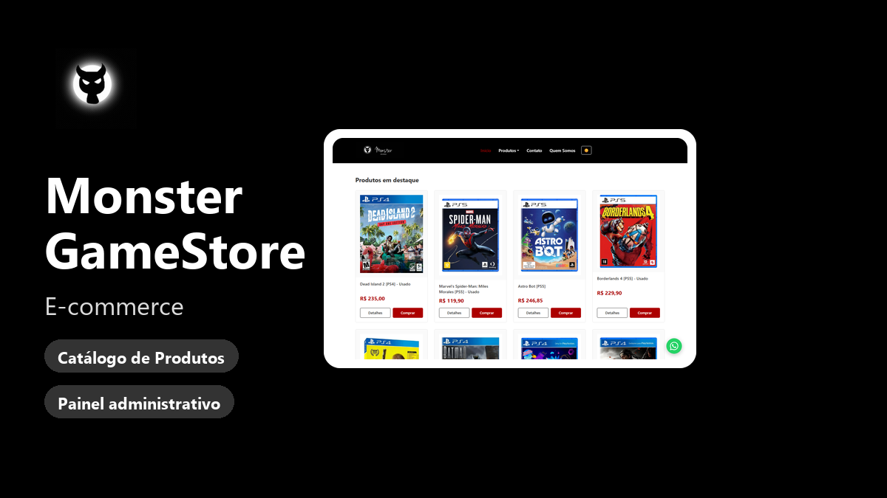
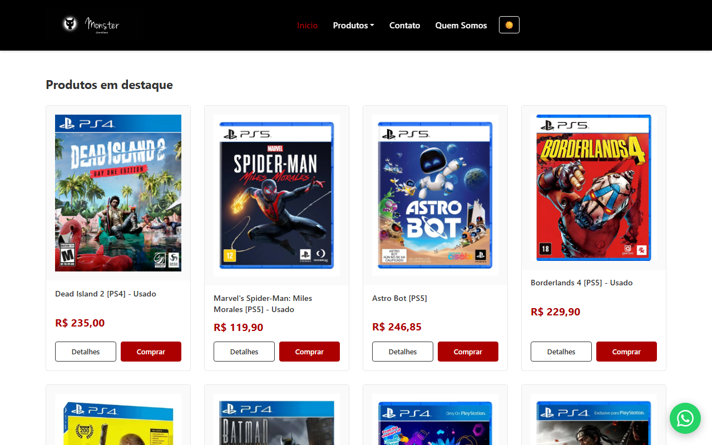
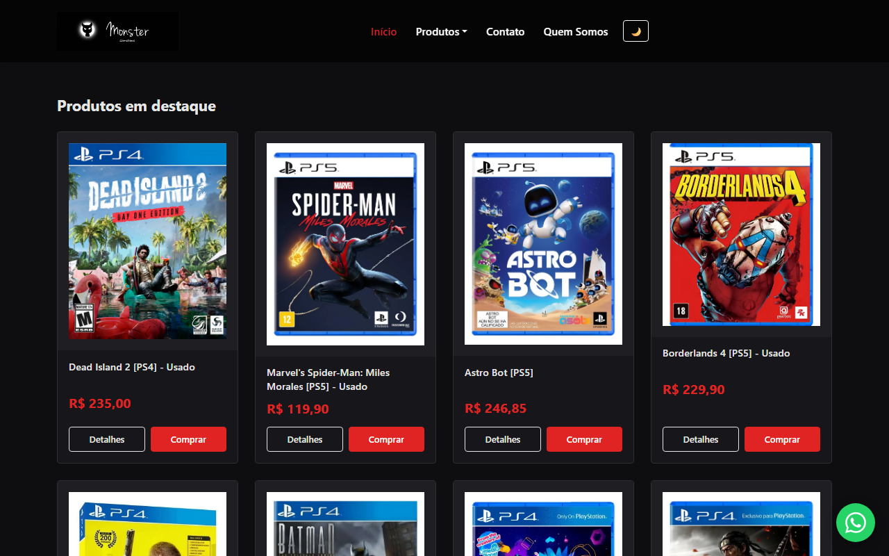

# Monster GameStore

  

## Português

Loja virtual com catálogo de produtos, páginas de detalhes e painel administrativo.

Acesse: https://monstergamestore.com.br/

### Telas

  

  

### Arquivos

| Arquivo | Descrição |
|---|---|
| [social-post.png](docs/images/social-post.png) | Post de divulgação (tema claro) |
| [social-post-dark.png](docs/images/social-post-dark.png) | Post de divulgação (tema escuro) |
| [icon.ico](docs/images/icon.ico) | Ícone da marca |

---

## English

Online store with a product catalog, detail pages and an admin panel.

Visit: https://monstergamestore.com.br/

### Screens

  

  

### Files

| File | Description |
|---|---|
| [social-post.png](docs/images/social-post.png) | Promo post (light theme) |
| [social-post-dark.png](docs/images/social-post-dark.png) | Promo post (dark theme) |
| [icon.ico](docs/images/icon.ico) | Brand icon |
